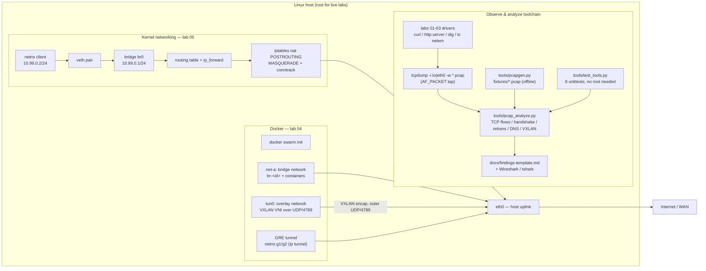
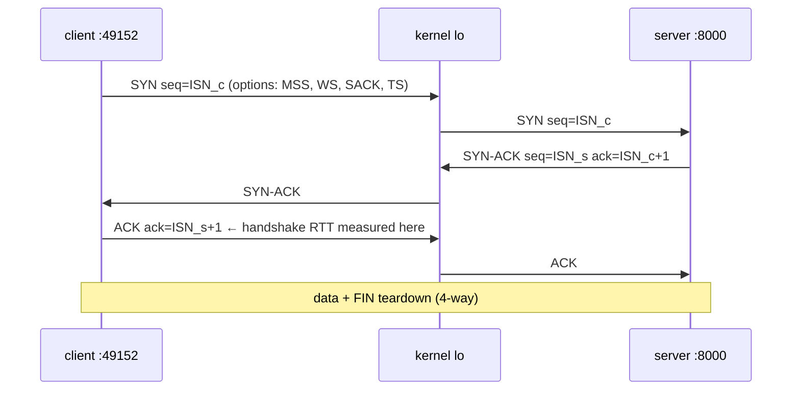
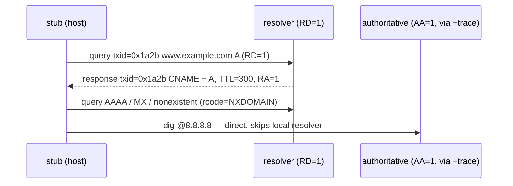

# packetlab — architecture

Whole-picture view of the project: what runs where, which artifacts flow where,
and how one packet travels through each lab topology.

Rendered diagram: [architecture-diagram.svg](architecture-diagram.svg)
(regenerate with `make diagram` — `tools/diagram.py`, stdlib only, no graphviz).

## Component map



## Artifact flow

```
labs/*/run.sh ──tcpdump──> labs/*/*.pcap ──> tools/pcap_analyze.py ──> terminal report / --json
                                                        │
tools/pcapgen.py ──> fixtures/*.pcap ──────────────────┘   (offline, no root)
                                                          │
                                          docs/findings-template.md + Wireshark
```

`.pcap` and `fixtures/` are gitignored; everything else is source.

## Packet paths per lab

### Lab 01 — TCP handshake (loopback)



Analyzer: `--handshake --flows --tcp` reports ISNs, options, RTT per flow.

### Lab 02 — retransmissions (loopback + netem loss)

```
client ──seg seq=X──X──> (lost by netem)
client ──seg seq=X──> at RTO+1s        (retransmission, backoff)
client ──seg seq=X──> at RTO+3s        (backoff doubles)
server ──ACK=X──> server ──ACK=X──> server ──ACK=X──>  (3 dup ACKs)
client ──seg seq=X──> immediately      (fast retransmit, within ~1 RTT)
```

Analyzer: `--retrans` labels each retransmission `rto` or `fast-retransmit`
with `since_first` and `dup_acks_before`.

### Lab 03 — DNS (uplink, UDP/53)



Analyzer: `--dns` decodes txid pairing, flags, questions, answers with TTLs.

### Lab 04 — Docker bridge vs. overlay (VXLAN)

```
bridge path : container ──veth──> br-<id> ──L2──> other container        (plain frames on the bridge)
overlay path: container ──veth──> vxlan dev ──encap──> outer IP/UDP/4789 ──> eth0 ──> peer host ──> decap ──> peer container
              inner frame = eth + ip + tcp/udp/icmp, VNI selects the L2 segment
GRE path    : netns g1 ──gre tunnel (24 B hdr)──> netns g2
MTU math    : VXLAN +50 B (20 IP + 8 UDP + 8 VXLAN + 14 eth)  → 1500 becomes 1450
              GRE +24 B (4 GRE + 20 IP)                            → 1500 becomes 1476
```

Analyzer: `--vxlan` prints outer src/dst + VNI + decoded inner packet
(see `fixtures/vxlan.pcap` offline).

### Lab 05 — bridge + NAT (netns → bridge → route → SNAT)

```
netns client 10.99.0.2 ──veth1/veth0──> br0 (L2 forward, MACs untouched)
        ──> routing decision (ip_forward=1, dst not local)
        ──> iptables nat POSTROUTING MASQUERADE (src IP → host uplink IP, conntrack entry)
        ──> eth0 ──> Internet
reply: Internet ──> conntrack ──> de-NAT ──> br0 ──> veth ──> client
```

`trace.sh` captures on `br0` and on the uplink simultaneously: same flow,
different src MAC (L2) and src IP (NAT) at each tap.

## Repo layout

```
tools/    pcap_analyze.py (decoder), pcapgen.py (fixtures), test_tools.py (tests), diagram.py (SVG)
labs/     01 handshake · 02 retransmissions · 03 DNS · 04 docker tunnels · 05 bridge+NAT
docs/     architecture.md (this file) · architecture-diagram.svg · deep-dive.md ·
          wireshark-filters.md · findings-template.md
Makefile  test · fixtures · analyze · diagram · clean
```
